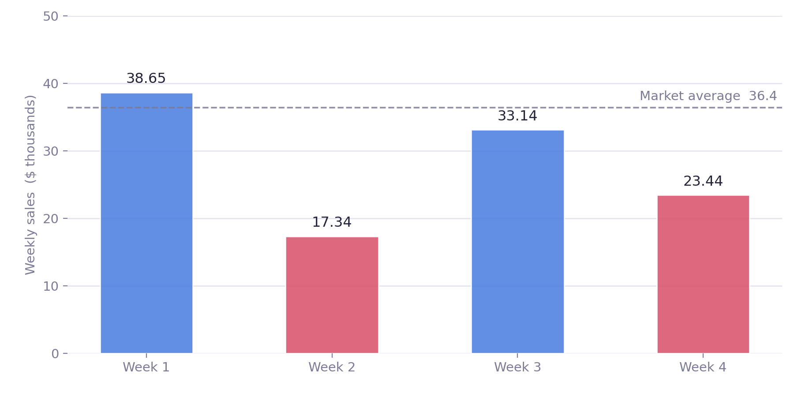
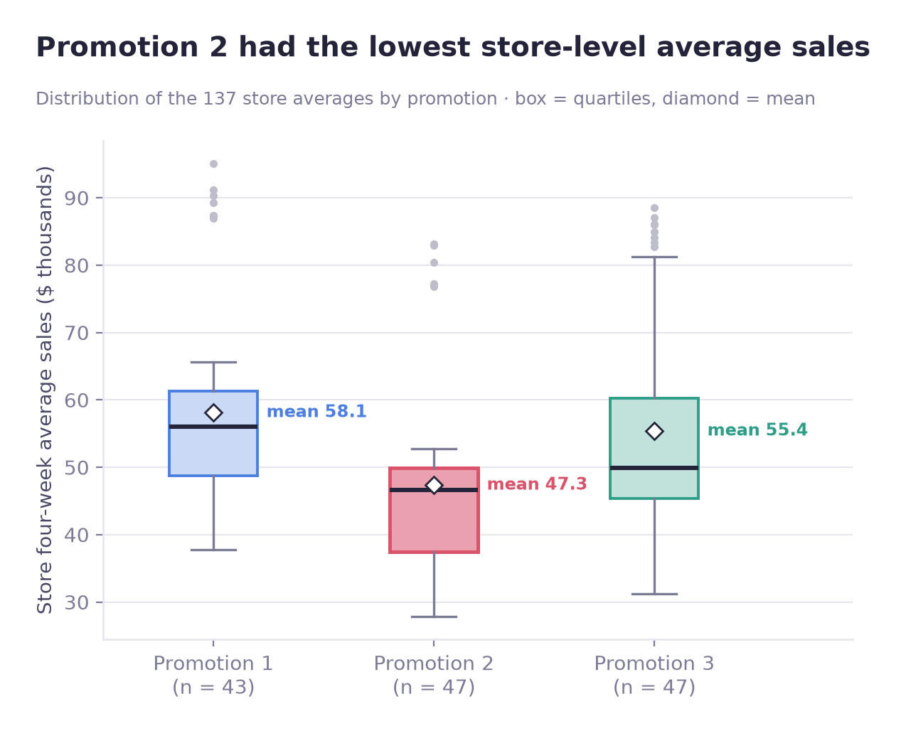
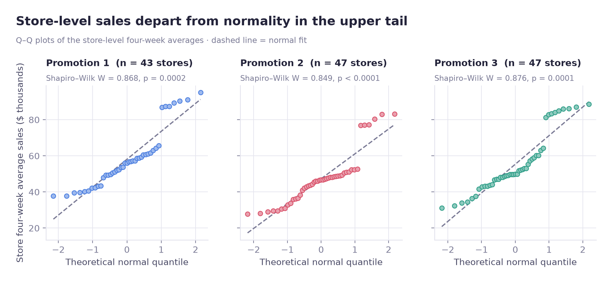
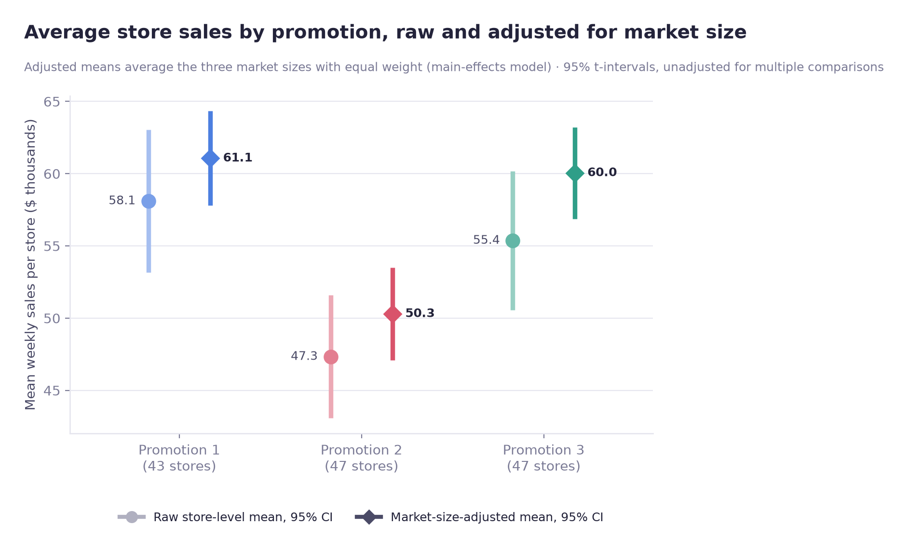
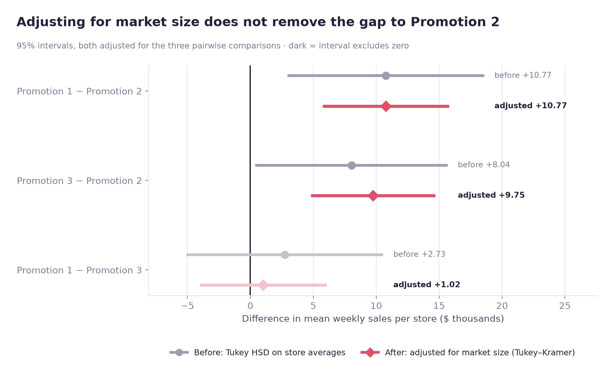
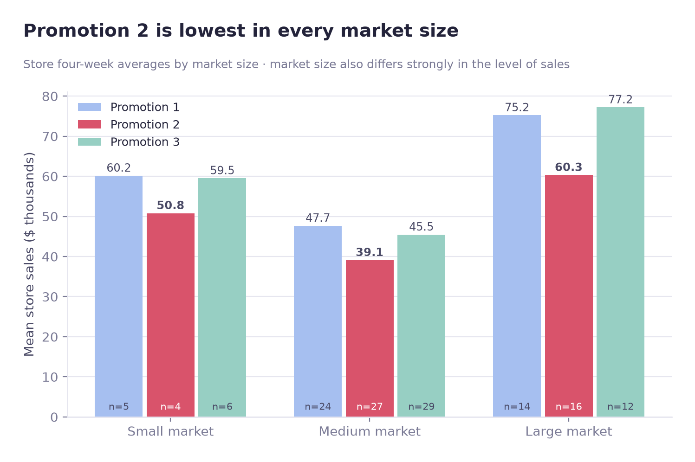
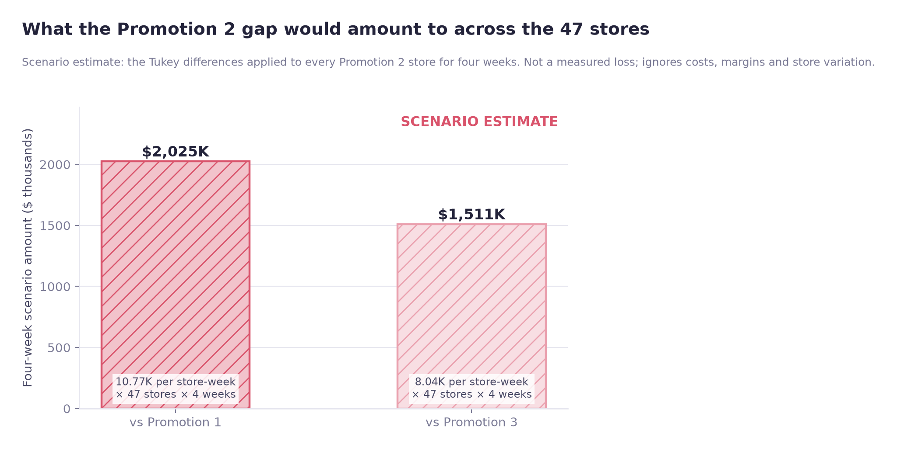

# Fast-Food Promotion A/B Test: Comparison of Three Campaigns

[한국어](README.ko.md) · [Kaggle dataset](https://www.kaggle.com/datasets/chebotinaa/fast-food-marketing-campaign-ab-test)

Full case study: https://jiwoon-oh.github.io/portfolio/projects/ab-test-fastfood/

**Data:** Fast Food Marketing Campaign A/B Test (Kaggle), treated here as hypothetical sample data. 548 weekly new-item sales observations from 137 stores (4 weeks each, 3 promotions). Primary analysis unit: the store average.

## Project background

The dataset description sets up a scenario in which a fast-food chain plans to add a new menu item and compares three possible promotions. The description does not say the data are real, and IBM's documentation labels the closely matching SPSS sample file `testmarket.sav` as hypothetical. Each store appears under a single promotion in the data, and weekly sales of the new item were recorded for four weeks. My goal was to compare the three options and decide which campaign the chain should consider keeping in this scenario.

Promotion 2 had the lowest average sales, but that alone was not a sound basis for a recommendation. The stores were in markets of different sizes, and four weekly observations from the same store are not four independent observations. I therefore started with the data structure, checked statistical assumptions, and tested whether the main result held under several alternative analyses.

**Promotion 2 had lower sales than both Promotion 1 and Promotion 3. I could not establish a statistically significant difference between Promotions 1 and 3.** There was also no no-promotion control group. The findings compare the three campaigns with each other; they do not establish how much additional revenue any campaign generated compared with doing nothing.

**Analysis unit.** The main analysis unit is the **store average**: one four-week mean sales value for each of the 137 stores. The 548 weekly rows are used only for exploration, outlier checks and the week-effect check, because the four weeks of one store are not independent observations.

## 1. Questions

1. Do mean store-level sales differ across the three promotions?
2. If they differ, which pairs of promotions account for the result?
3. Could market size, store age, or unusual sales observations explain the difference?
4. Does the answer survive alternative statistical tests and sensitivity checks?

The business decision concerns revenue performance (weekly sales of the new menu item, not total store sales). Profitability requires cost information that is not in this dataset.

## 2. Data

### Source and structure

I used Kaggle's *Fast Food Marketing Campaign A/B Test* dataset (credited there to the IBM Watson Analytics community) for a portfolio analysis. Its scenario text matches IBM's description of the SPSS sample file `testmarket.sav`, which IBM calls hypothetical. I could not confirm that the two files are identical, so I treat the data as hypothetical sample data, not as real company results. IBM's description documents random selection of markets, not random assignment of promotions. The data do not let me verify how promotions were assigned or calculate campaign costs.

| Item | Count |
|---|---:|
| Observations | 548 |
| Variables | 7 |
| Unique stores | 137 |
| Observed weeks per store | 4 |
| Promotion groups | 3 |

| Column | Meaning |
|---|---|
| `MarketID` | Identifier for the market containing the store |
| `LocationID` | Store identifier |
| `MarketSize` | Small, Medium, or Large market |
| `Promotion` | Campaign recorded for the store (1, 2, or 3) |
| `week` | Observation week |
| `SalesInThousands` | Weekly sales of the new menu item, in thousands of USD |
| `AgeOfStore` | Age of the store |

Although promotions were recorded as numbers, I treated them as categories rather than an ordered numerical variable.

### Data-quality checks

Before running tests, I checked the structure of the data and the consistency of the promotion records.

| Check | Result |
|---|---|
| Missing values | None |
| Duplicate rows | None |
| Duplicate store-week combinations | None |
| Stores listed under more than one promotion | None |
| Stores listed under more than one market | None |
| Stores with fewer or more than four weekly records | None |

These checks did not reveal missing records or conflicting assignment data within the dataset.

## 3. Sample Ratio Mismatch (SRM)

An unusually uneven allocation of stores could point to a problem with how promotions were assigned. I checked sample ratio mismatch at the **store level**, not at the row level, because each store appears under a single promotion in the data. The source documents random selection of markets, not random assignment of promotions, so how the promotions were assigned is not documented.

- Units checked: **137 stores**
- Chi-square allocation check: **p = 0.8898**
- Significance threshold: `α = 0.05`

I found no evidence of an allocation-ratio mismatch under the assumed equal-allocation design. This is a useful check, but it does not show that promotions were randomly assigned: the source documents random selection of markets, not random assignment of promotions.

## 4. Outlier review

An IQR-based scan flagged several relatively high sales observations. Many of them belonged to `MarketID = 3` and stores in **Large** markets. Higher sales in a larger market can be genuine business variation, not necessarily a recording error.

### Store `LocationID = 507`

One weekly observation was unusually low relative to other stores. I considered both a data-entry error and an actual short-term disruption, such as stock shortages or temporary operational issues.

- The unusual value did not establish a pattern across all four weeks.
- I had no direct evidence that it was entered incorrectly.
- I could evaluate its influence with a sensitivity analysis later.

I kept the record in the initial analysis rather than removing it automatically. A flagged outlier is a reason to investigate, not by itself a reason to discard data.



## 5. Unit of analysis: 137 store averages instead of 548 weekly rows

Every store appears four times in the raw data. Weekly sales from one store are likely related: a store that sells more than others in Week 1 will often remain relatively strong in Week 2. Treating all 548 observations as independent would overstate the amount of independent information available.

There were two reasonable approaches:

| Approach | Benefit | Trade-off |
|---|---|---|
| Average the four weeks for each store | One observation per store (each store carries one promotion); clear comparison of store averages | Loses week-to-week detail |
| Repeated-measures ANOVA or a mixed-effects model | Retains weekly records and accounts for within-store dependence | More demanding model specification and interpretation |

### Week effect and between-store variation

I checked whether there was a common week effect before aggregating the observations.

- Week-effect test: `p = 0.9935` (a reference analysis on the 548 weekly rows that treats repeated weeks of the same store as independent)
- Between-store variation was about **3.4 times** within-store weekly variation.

There was no detected common week effect across the four weeks, while persistent differences between stores were much larger. I chose the **four-week average sales per store** as the main outcome, leaving 137 store-level observations. Independence between stores, including stores in the same market, is assumed and was not verified.

This was a practical choice for the question at hand, not a claim that aggregation is always preferable. A mixed-effects model would be a useful extension if weekly dynamics were the main focus.

## 6. Exploring sales distributions

The combined distribution looked somewhat bimodal. The grouping of markets and campaigns appeared to explain part of that shape, and larger markets contributed several high-sales observations.



The chart suggested that Promotion 2 performed less well. I still needed to check whether that apparent difference could reasonably be attributed to sampling variation.

## 7. Statistical testing

### Hypotheses

- **H₀:** Mean store-level sales are equal under Promotions 1, 2, and 3.
- **H₁:** At least one group has a different mean.
- **Significance level:** `α = 0.05`.

### 7.1 Normality: Q–Q plots and Shapiro–Wilk

The Q–Q plots showed similar patterns across the campaigns, but their upper tails departed from the theoretical normal distribution. Shapiro–Wilk tests also indicated departures from normality.

I used one-way ANOVA for a comparison of means and added Kruskal–Wallis as a nonparametric check. This way, the conclusion would not rely on a single set of distributional assumptions.



### 7.2 Equal variances: Levene's test

- Null hypothesis: sales variances are equal across the three groups.
- Result: **p = 0.6272**.

There was insufficient evidence to reject equal variances. That does not establish that the three true variances are exactly the same; it means this sample did not show a clear difference.

### 7.3 One-way ANOVA

- **F = 5.8458**
- **p = 0.0037**

The three means were not all consistent with a common group mean. ANOVA does not identify which specific promotions differ, so I followed it with pairwise comparisons.

### 7.4 Kruskal–Wallis

I also ran a rank-based comparison because the normality assumption was not fully met.

- **H = 17.3274**
- Degrees of freedom: `2`
- **p = 0.0002**
- Chi-square critical value at `α = 0.05`: `5.9915`

This test also found differences among the groups. Strictly speaking, Kruskal–Wallis concerns the distributions/ranks, not precisely the same mean parameter as ANOVA. Their agreement makes the overall finding less dependent on one test.

### 7.5 Tukey HSD: locating the differences

| Comparison | Mean weekly new-item sales difference per store | Tukey-adjusted p-value | Cohen's d | Interpretation |
|---|---:|---:|---:|---|
| Promotion 1 − 2 | approx. **+$10,770** | **0.004** | **0.706** | Significant; medium-to-large gap |
| Promotion 1 − 3 | approx. **+$2,735** | 0.6862 | 0.169 | No detected significant difference |
| Promotion 3 − 2 | approx. **+$8,035** | **0.037** | **0.519** (absolute value) | Significant; medium-sized gap |

With the opposite comparison order, the original Cohen's d for Promotion 2 versus 3 is reported as `−0.519`. The table uses the absolute magnitude for readability.

![Tukey HSD 95% intervals before market-size adjustment: Promotion 1 minus 2 is +10.77 [2.94, 18.60], Promotion 3 minus 2 is +8.04 [0.39, 15.68], Promotion 1 minus 3 is +2.73 [−5.09, 10.56]](images/tukey.png)

Promotion 2 had significantly lower sales than either alternative. Promotion 1 versus 3 was not statistically significant, but **lack of significance is not proof of equivalence**. The data were not strong enough to establish which of those two performs better.

### 7.6 Effect size: eta squared

- **η² = 0.0802**
- Roughly **8%** of the observed variation in store sales was associated with promotion-group differences.

Conventional reference values sometimes label η² of 0.01, 0.06, and 0.14 as small, medium, and large. By that rule, this was a medium-sized association. Market size, store characteristics, age, and other unobserved factors could account for much of the remaining variation.

## 8. Sensitivity to one unusual observation

I repeated the ANOVA after temporarily excluding the unusual record from `LocationID = 507`.

| Data | F | p-value |
|---|---:|---:|
| Original data | 5.8458 | 0.0037 |
| After exclusion | 5.7780 | 0.0039 |

The result hardly changed. The overall conclusion was not driven by this observation, so I retained the original data for the final analysis.

## 9. Market size and store age as alternative explanations

If Promotion 2 had been used mainly in smaller markets, its lower average sales might reflect market composition rather than the campaign. I checked group balance and then ran a model that accounted for market size.

### 9.1 Promotion versus market size

- Promotion-by-market-size association test: **p = 0.8800**

I found no evidence that market sizes were distributed differently across promotion groups. In particular, there was no detected tendency for Promotion 2 to be concentrated in smaller markets.

### 9.2 Store age

- Store-age comparison across campaigns: **F = 0.4499**, **p = 0.6387**

Store age also did not show a significant group difference. Neither observed characteristic showed an imbalance across the promotion groups.

### 9.3 Market-size-adjusted analysis

The analysis unit is the same 137 store averages as in section 7. Before running the models I fixed how I would read them: if the interaction between promotion and market size was not significant, I would interpret the main-effects model, and a pairwise difference would count as separated only if its 95% interval, adjusted for the three comparisons, excluded zero.

| Term (Type II ANOVA) | F | p | Partial η² |
|---|---:|---:|---:|
| `Promotion` | **16.04** | 5.8e−07 | 0.195 |
| `MarketSize` | **96.13** | 1.7e−26 | 0.593 |

The `Promotion × MarketSize` interaction had F = 1.32 and **p = 0.2659**. It was not significant, so I interpreted the main-effects model. The Small market has only 15 stores (5, 4 and 6 per promotion), so the power to detect an interaction is low.



Adjusted means average the three market sizes with equal weight: 61.06, 50.29 and 60.05 thousand dollars for Promotions 1, 2 and 3, against raw means of 58.10, 47.33 and 55.36.

| Comparison | Before: Tukey difference [95% CI] | After: market-size-adjusted difference [Tukey–Kramer 95% CI] |
|---|---|---|
| Promotion 1 − 2 | +$10.77K [2.94, 18.60] | +$10.77K [5.73, 15.80] |
| Promotion 3 − 2 | +$8.04K [0.39, 15.68] | +$9.75K [4.82, 14.69] |
| Promotion 1 − 3 | +$2.73K [−5.09, 10.56] | +$1.02K [−4.03, 6.06] |



After adjusting for market size, Promotion 2 was still lower than both Promotion 1 and Promotion 3. Promotions 1 and 3 could still not be separated; their interval includes zero, which does not show that they are equal. Adjusting for the observed market size does not control unobserved store characteristics, so it does not establish a causal effect.



### 9.4 Multiple comparisons

The segment-level analysis runs three separate tests: a one-way ANOVA of Promotion within each market size (Small, n = 15 stores; Medium, n = 80; Large, n = 42). Running several tests increases the chance of a statistically significant result appearing by accident, so I applied two adjustments to these three p-values:

- **Bonferroni correction**, which tightens the significance threshold based on the number of tests.
- **Benjamini–Hochberg correction**, which controls the false discovery rate among rejected hypotheses.

| Segment | Raw p | Bonferroni p | Benjamini–Hochberg p |
|---|---:|---:|---:|
| Small | 0.003183 | 0.009550 | 0.004775 |
| Medium | 0.000104 | 0.000313 | 0.000313 |
| Large | 0.007732 | 0.023195 | 0.007732 |

All three segment tests stayed below 0.05 under both corrections. These are three-group ANOVAs within each segment; pairwise differences within segments were not tested, and the per-segment means (Promotion 2 lowest in all three) are descriptive. No other correction was applied. The omnibus tests (Levene, ANOVA, Kruskal–Wallis) are parallel tests of the same null hypothesis and were not corrected against each other, and the Tukey HSD pairwise p-values and the Tukey–Kramer intervals carry Tukey's own family-wise adjustment. The **Small Market** segment had only **15 stores**, so its result rests on a small sample and I treated it more cautiously.

## 10. Scenario estimate of the revenue gap

Statistical significance and the size of the gap in dollars are separate questions. To illustrate the possible scale of the observed difference, I applied the average weekly store-level differences in new-item sales to 47 stores over four weeks as a scenario. Because the data are hypothetical sample data, this is an illustration of the method, not a real revenue estimate.

| Reference | Weekly difference per store | 47 stores × 4 weeks |
|---|---:|---:|
| Promotion 1 versus Promotion 2 | approx. $10,770 | **approx. $2,024,700** |
| Promotion 3 versus Promotion 2 | approx. $8,035 | **approx. $1,510,600** |

The amounts are computed in `promotion_ab_test.ipynb` and saved in `outputs/business_scenario.csv`. They are **scenario estimates** based on the Tukey differences before market-size adjustment, not recorded losses or a measured causal increase from switching campaigns. They do not account for implementation costs, differing store responses, seasonality, or profit margins.



## 11. Main findings

1. **Promotion 2 had lower sales than both alternatives.** ANOVA, Kruskal–Wallis, and Tukey HSD support a difference, with Promotion 2 below the other two.
2. **Promotions 1 and 3 could not be clearly separated.** Their difference was not statistically significant, which is not the same as proving that they are equal.
3. **Market size is strongly associated with sales.** The estimated promotion difference remained after market-size adjustment (interaction p = 0.2659).
4. **The result held across the checks that were run.** Nonparametric testing and an outlier sensitivity analysis gave the same conclusion, and the three market-size segment tests stayed significant after Bonferroni and Benjamini–Hochberg correction (pairwise differences within segments were not tested).

## 12. Business recommendation

### Reconsider Promotion 2

In this hypothetical scenario, the observed new-item sales would argue for **pausing or reviewing Promotion 2 before continuing it unchanged**. It underperformed both alternatives, and the difference remained in the checks available here.

### Compare cost and execution when choosing between 1 and 3

The revenue data did not establish a winner between Promotions 1 and 3. I would want to compare:

- Discounts, advertising spend, and promotion execution cost
- Labor, inventory, logistics, and operational complexity
- New-customer acquisition, repeat purchases, and retention
- Sales after the campaign finishes

If revenue performance is similar, the option with lower execution costs may be the better business decision.

## 13. Limitations

| Limitation | Why it matters |
|---|---|
| Only four weeks of observations | Cannot evaluate longer-term retention or novelty effects |
| Aggregation to the store level | Resolves part of the dependence issue but discards weekly patterns |
| No promotion or operating cost data | Cannot assess profit, ROI, or full economic return |
| No no-promotion group | Can compare alternatives, not absolute incremental promotion lift |
| Limited operational detail | Stockouts, closures, or other unobserved conditions could matter |
| Incomplete allocation documentation | The source documents random selection of markets, not random assignment of promotions; the assignment procedure is not documented, and a passing SRM check does not prove random assignment |
| Hypothetical sample data | IBM labels the matching SPSS sample file as hypothetical; findings illustrate the method and are not evidence about real campaigns |

## 14. Improvements I would make next

- Fit a **mixed-effects model** using weekly records and store-specific effects.
- Collect a longer observation window to evaluate persistence.
- Bring in campaign spend and operational costs to compare profit rather than revenue alone.
- Link customer-level acquisition, visit frequency, and repeat purchase outcomes.
- Estimate interactions between market characteristics and campaign type.
- If possible, include a no-promotion arm to estimate absolute incremental lift.

## 15. Tools and methods

- **Data analysis:** Python, pandas, NumPy, SciPy, statsmodels
- **Visualization:** Matplotlib, Seaborn
- **Testing:** SRM, Shapiro–Wilk, Levene, one-way/two-way ANOVA, Kruskal–Wallis, Tukey HSD, Cohen's d, eta squared, Bonferroni, Benjamini–Hochberg
- **Workflow:** Data validation, analysis-unit selection, exploratory analysis, outlier assessment, confounding checks, sensitivity analysis, business interpretation

## 16. My work

I defined the comparison, validated the data structure and assignment consistency, checked assignment ratios and unusual observations, selected the store-level analysis unit, ran assumption checks and statistical tests, evaluated effect sizes and potential confounders, tested robustness, and developed the business recommendation.

**Bottom line:** Promotion 2 consistently showed lower sales. The decision between Promotions 1 and 3 should be based on cost, operational considerations, and longer-term customer outcomes that were not available in this dataset.

## How to run

```
pip install -r requirements.txt
pip install jupyter
```

The pinned versions are those of the Python 3.11 environment the notebooks were run in.

1. Download `WA_Marketing-Campaign.csv` into `data/` (see `data/README.md`). It is git-ignored.
2. Run the notebooks from the repository root: `promotion_ab_test`, then `ab_figures`. `config.py` sets all paths and `SEED = 42`.

   ```
   python -m nbconvert --to notebook --execute --inplace <notebook>.ipynb
   ```

   `promotion_ab_test` writes the result CSVs to `outputs/`; `ab_figures` draws the figures in `images/` from those CSVs (set `TRANSPARENT = True` for transparent versions).
